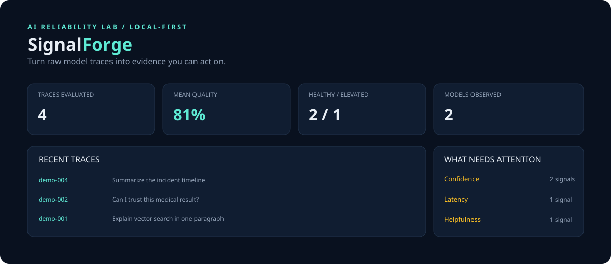

# SignalForge

> **AI reliability, with receipts.**

SignalForge is a local-first evaluation and observability lab for AI systems. It turns model traces into transparent quality signals, risk-aware triage, and evidence a team can actually discuss. It is intentionally small enough to understand in one sitting and structured like a real service: typed domain models, a persistence boundary, an HTTP API, a dashboard, deterministic examples, and automated tests.



## Why this project

Most AI demos optimize for a happy-path chat. Production engineering is different: you need to know when outputs drift, when latency breaks the UX, when a refusal is unhelpful, and when sensitive data leaks into a response. SignalForge makes those failure modes visible without hiding them behind one opaque score.

### What it demonstrates

- **Explainable evaluation:** reference alignment, confidence language, safety/privacy, helpfulness, and latency checks each return a score, status, explanation, and evidence.
- **Risk-aware triage:** aggregate scores become `healthy`, `elevated`, or `critical`, while individual findings preserve the reason.
- **Real service boundaries:** traces enter through a JSON API, are evaluated by a pure domain layer, and persist in SQLite.
- **A product surface:** the dashboard is a responsive, dependency-free UI that makes the signal legible in seconds.
- **Engineering discipline:** typed dataclasses, explicit input errors, bounded request bodies, deterministic tests, and CI from the first commit.

## Quick start

```bash
python -m venv .venv
source .venv/bin/activate
python -m pip install -e .
signalforge serve
```

Open [http://127.0.0.1:8000](http://127.0.0.1:8000) and click **Load demo traces**.

Evaluate the included JSONL from the command line:

```bash
signalforge evaluate examples/traces.jsonl
```

Or send a trace to the API:

```bash
curl -X POST http://127.0.0.1:8000/api/evaluate \
  -H 'content-type: application/json' \
  -d '{"trace_id":"quickstart-1","input":"What is RAG?","output":"RAG retrieves context before generation.","latency_ms":220,"model":"atlas-2"}'
```

## Architecture

```text
JSONL / SDK / API client
          |
          v
   Trace.from_dict  ---> explicit validation
          |
          v
       evaluator   ---> independent, inspectable checks
          |
          +---------> ScoredTrace + evidence
          |
          v
   SQLite TraceStore ---> dashboard / CLI / future integrations
```

The evaluator is deliberately dependency-free and deterministic. That makes it useful as a regression harness today, while keeping the seam clear for replacing an individual check with a model-backed judge, an embedding similarity metric, or a policy engine later.

## Repository map

| Path | Purpose |
| --- | --- |
| `signalforge/models.py` | Validated trace and scoring domain types |
| `signalforge/evaluator.py` | Explainable quality and risk checks |
| `signalforge/store.py` | SQLite persistence boundary |
| `signalforge/server.py` | Small, concurrent HTTP API and static app |
| `signalforge/web/index.html` | Product dashboard |
| `examples/traces.jsonl` | Ready-to-run sample data |
| `tests/` | Domain and API coverage |

## Roadmap

- Pluggable evaluators with a stable `Evaluator` protocol
- Dataset/version tracking and baseline-vs-candidate regression gates
- OpenTelemetry trace ingestion
- Embedding-backed semantic similarity and configurable policy packs
- Exportable review reports for human-in-the-loop annotation

## License

MIT
